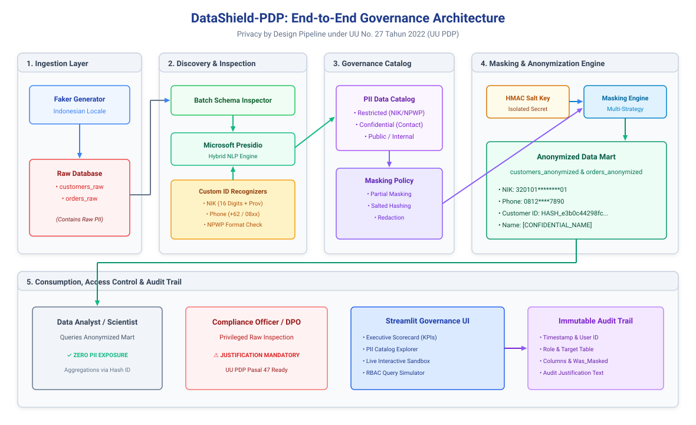
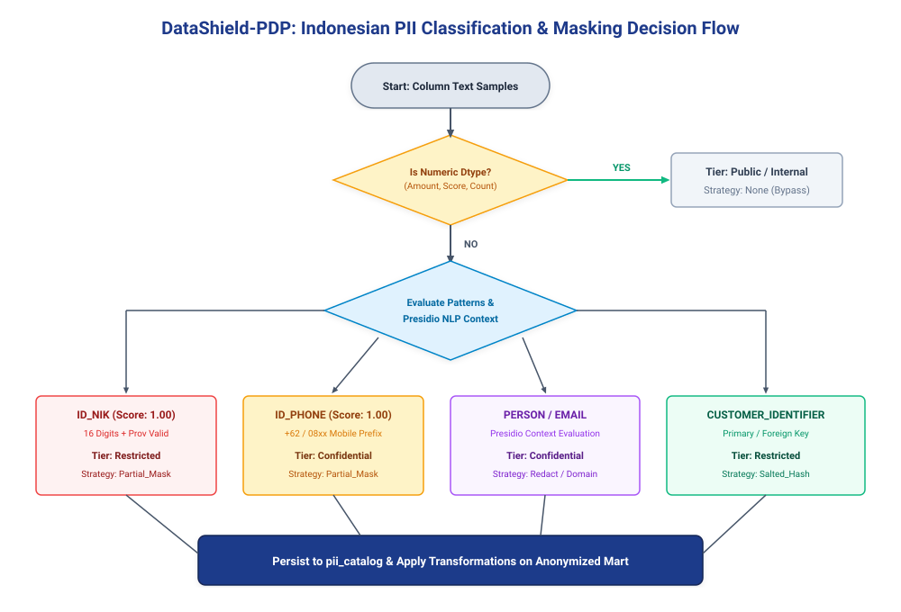
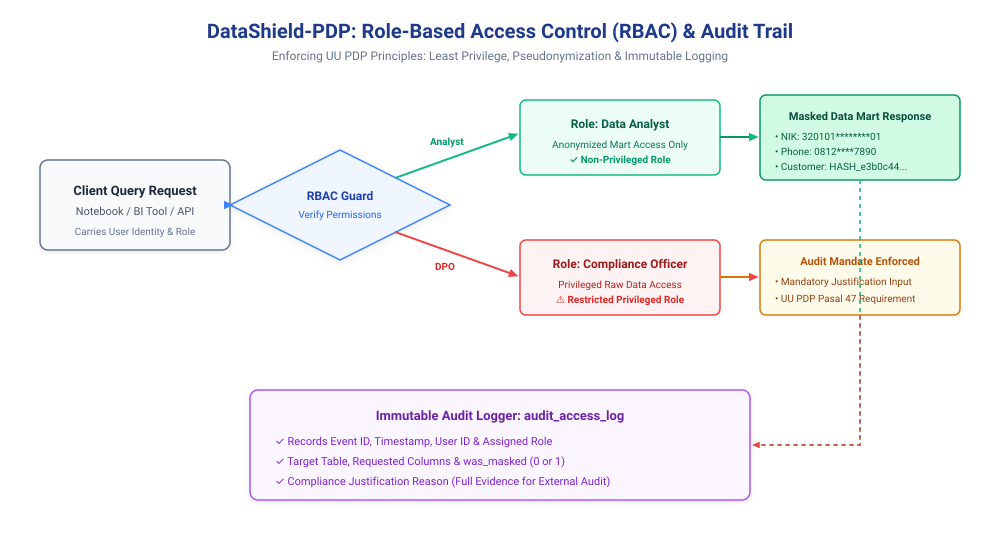

# 🛡️ DataShield-PDP: Automated PII Scanner & Compliance Engine

[](https://www.python.org/)
[](LICENSE)
[](docs/UU_PDP_MAPPING.md)
[](https://github.com/microsoft/presidio)
[](https://datashield-pdp.streamlit.app/)
[-brightgreen.svg)](tests/)

> **DataShield-PDP** adalah framework data governance dan privasi data end-to-end yang dirancang khusus untuk memenuhi standar **Undang-Undang Pelindungan Data Pribadi (UU PDP No. 27 Tahun 2022)** Indonesia. Sistem ini secara otomatis memindai, mengklasifikasi, dan melakukan pseudonimisasi data sensitif pada data warehouse/analytics pipeline sebelum data dapat diakses oleh tim data.

> [!NOTE]
> 🌐 **Live Interactive Demo:** [https://datashield-pdp.streamlit.app/](https://datashield-pdp.streamlit.app/)  
> *Coba langsung fitur PII Catalog, live sandbox deteksi NIK/HP, dan simulasi akses RBAC tanpa perlu instalasi lokal!*

---

## 📌 Mengapa Project Ini Penting?

Di era modern, perusahaan menghadapi ancaman sanksi denda kepatuhan hingga **2% dari pendapatan tahunan** bila lalai melindungi data pribadi nasabah/pelanggan. Sebagian besar kebocoran data internal terjadi karena tim analitik atau AI engineer memiliki akses langsung ke data produksi mentah (*unmasked data*).

**DataShield-PDP menyelesaikan masalah ini dengan:**
1. **Zero Exposure:** Mengisolasi data mentah dan secara otomatis membuat *Anonymized Analytics Mart*.
2. **Indonesian Entity-Aware:** Mendeteksi NIK (16 digit), NPWP, dan nomor telepon lokal secara akurat menggunakan kombinasi Regex & Contextual NLP.
3. **Analytics-Friendly Masking:** Menggunakan *Cryptographic Salted Hashing (HMAC-SHA256)* sehingga analis tetap bisa melakukan agregasi `COUNT(DISTINCT)` dan `JOIN` tanpa mengetahui identitas asli pelanggan.
4. **Automated Audit Trail:** Mencatat setiap aktivitas scan dan akses data untuk kebutuhan audit eksternal/internal.

---

## 📐 Arsitektur Sistem & Alur Kerja (Draw.io Diagrams)

> [!TIP]
> Semua diagram arsitektur di bawah ini tersedia dalam format vector dan file sumber **Draw.io (`.drawio`)**. Anda dapat membuka dan mengedit file `.drawio` secara langsung melalui [app.diagrams.net](https://app.diagrams.net/) atau extension Draw.io di VS Code.

### 1. End-to-End Governance Architecture

*File sumber Draw.io:* [📄 docs/diagrams/system_architecture.drawio](docs/diagrams/system_architecture.drawio)

---

### 2. Logika Deteksi PII Khusus Entitas Indonesia

*File sumber Draw.io:* [📄 docs/diagrams/pii_detection_logic.drawio](docs/diagrams/pii_detection_logic.drawio)

---

### 3. Kontrol Akses Data Berbasis Peran (RBAC) & Jejak Audit

*File sumber Draw.io:* [📄 docs/diagrams/rbac_access_flow.drawio](docs/diagrams/rbac_access_flow.drawio)

---

## ⚖️ Kepatuhan Regulasi: Pemetaan UU PDP No. 27/2022

| Pasal UU PDP | Ketentuan Regulasi | Solusi Teknis DataShield-PDP | Verifikasi / Bukti Kepatuhan |
|---|---|---|---|
| **Pasal 16 Ayat (2)** | Pemrosesan Data Pribadi dilakukan secara terbatas, spesifik, dan sah. | **Automated Data Catalog:** Membatasi visibilitas dan menginventarisasi kolom sensitif. | Tabel `pii_catalog` di metadata catalog. |
| **Pasal 35** | Pengendali Data Pribadi wajib melindungi dan memastikan keamanan Data Pribadi. | **Role-Based Access Control (RBAC):** Membatasi akses langsung ke layer produksi. | Modul `audit_logger.py` & simulator RBAC. |
| **Pasal 39** | Kewajiban menerapkan enkripsi dan/atau teknik pseudonimisasi. | **Cryptographic Salted Hashing & Dynamic Masking:** Menghilangkan data mentah dari konsumsi terbuka. | Fungsi `hash_pseudonym()` pada `apply_masking.py`. |
| **Pasal 47** | Kewajiban mendokumentasikan seluruh kegiatan pemrosesan data pribadi. | **Immutable Audit Trail:** Setiap query dan running scan dicatat secara permanen. | Tabel `audit_access_log` di database audit. |

---

## 🚀 Quickstart: Menjalankan Project dalam 3 Menit

### 1. Setup Environment
```bash
git clone https://github.com/username/DataShield-PDP.git
cd DataShield-PDP

# Buat virtual environment (atau gunakan uv)
python3 -m venv .venv
source .venv/bin/activate  # Untuk Windows: .venv\Scripts\activate

# Install dependencies & spaCy language model
pip install -r requirements.txt
python -m spacy download en_core_web_sm
```

### 2. Generate Data Sintetis (100% Aman & Legal)
```bash
python src/generator/generate_mock_data.py
```

### 3. Jalankan Automated PII Scan & Anonymizer
```bash
# Pindai seluruh tabel dan daftarkan ke Governance Catalog
python src/scanner/run_scanner.py

# Eksekusi masking dan buat Anonymized Data Mart
python src/masker/apply_masking.py
```

### 4. Buka Compliance & Monitoring Dashboard
```bash
streamlit run src/ui/dashboard.py
```
Akses dashboard di browser kamu melalui `http://localhost:8501`.

### 5. Jalankan Unit Tests
```bash
pytest tests/ -v
```

---

## 📂 Struktur Direktori

```text
DataShield-PDP/
├── data/
│   ├── raw/                  # Data sintetis mentah (faker output)
│   ├── anonymized/           # Data mart hasil masking
│   └── metadata/             # Database metadata (katalog & audit logs)
├── docs/
│   ├── PRD.md                # Dokumen PRD lengkap
│   ├── ARCHITECTURE.md       # Arsitektur & spesifikasi teknis
│   └── UU_PDP_MAPPING.md     # Rincian kepatuhan hukum UU PDP
├── src/
│   ├── config.py             # Konfigurasi path dan salt secret
│   ├── generator/            # Script pembuatan synthetic data
│   │   └── generate_mock_data.py
│   ├── recognizers/          # Custom Presidio Recognizer (NIK, NPWP, HP)
│   │   ├── nik_recognizer.py
│   │   ├── phone_recognizer.py
│   │   └── npwp_recognizer.py
│   ├── scanner/              # Engine pemindaian database
│   │   └── run_scanner.py
│   ├── masker/               # Engine anonimisasi data
│   │   └── apply_masking.py
│   ├── audit/                # Logging audit & katalog metadata
│   │   └── audit_logger.py
│   └── ui/                   # Streamlit Compliance Dashboard
│       └── dashboard.py
├── tests/                    # Unit test recognizer, masker, & generator
│   ├── test_generator.py
│   ├── test_masker.py
│   └── test_recognizers.py
├── .env.example
├── Dockerfile
├── docker-compose.yml
├── requirements.txt
└── README.md
```

---

## 🔒 Kebijakan Keamanan & Etika
Proyek ini dibuat murni menggunakan data buatan (*synthetic mock data*) untuk tujuan edukasi, penelitian rekayasa tata kelola data, dan portofolio profesional. Tidak ada data asli masyarakat Indonesia yang dihimpun ataupun diproses dalam sistem ini.

## 📄 Lisensi
Didistribusikan di bawah lisensi Apache 2.0. Lihat [LICENSE](LICENSE) untuk informasi lebih lanjut.
