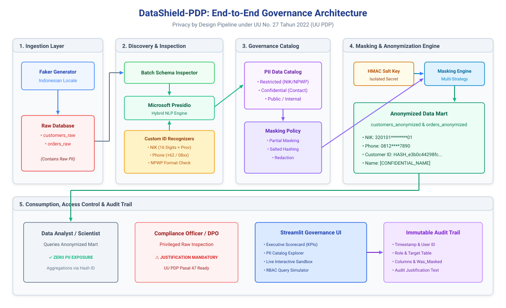

# Technical Architecture & Design Document

## System: DataShield-PDP

---

## 1. Architectural Overview

DataShield-PDP dirancang dengan prinsip **Decoupled Architecture** dan **Privacy by Design**:

*File sumber Draw.io:* [diagrams/system_architecture.drawio](diagrams/system_architecture.drawio)

---

---

## 2. Key Design Decisions

### 2.1 Mengapa Memakai Microsoft Presidio?
- **Hybrid Approach:** Presidio menggabungkan aturan berbasis pola (*Rule/Regex*) dengan pemrosesan bahasa alami (*Context-aware Spacy NLP*).
- **Contoh:** Angka 16 digit dapat dibedakan antara NIK, nomor kartu kredit, atau ID pesanan acak berdasarkan kata-kata konteks di sekitarnya (seperti "KTP", "NIK", "Kependudukan", "Nomor Induk").
- **Ekstensibilitas:** Mendukung pembuatan `CustomPatternRecognizer` tanpa perlu melakukan *retraining* model bahasa dari nol.

### 2.2 Mengapa Memilih Salted Hashing dibanding Enkripsi Simetris?
- **Kebutuhan Analisis Data:** Data Analyst dan ML Engineer hanya membutuhkan konsistensi entitas (misal: "Berapa banyak transaksi yang dilakukan oleh customer ini?").
- **No Decryption Risk:** Dengan *Salted SHA-256 Hashing*, data identitas asli tidak dapat di-dekripsi meskipun database analitik bocor.
- **KMS / Salt Management:** Kunci *Salt* disimpan di luar database (via Environment Variables/Secret Manager).

### 2.3 Mekanisme Validasi NIK Indonesia
NIK terdiri dari 16 digit terstruktur:
1. **Digit 1-2:** Kode Provinsi (Validasi nilai 11 s.d. 94).
2. **Digit 3-4:** Kode Kabupaten / Kota.
3. **Digit 5-6:** Kode Kecamatan.
4. **Digit 7-12:** Tanggal Lahir (DDMMYY). Untuk wanita, tanggal ditambah 40 (01-31 untuk pria, 41-71 untuk wanita).
5. **Digit 13-16:** Nomor Urut Registrasi (0001 - 9999).

Validator custom kami memverifikasi pola digit sekaligus kelayakan rentang tanggal dan kode wilayah dasar.
